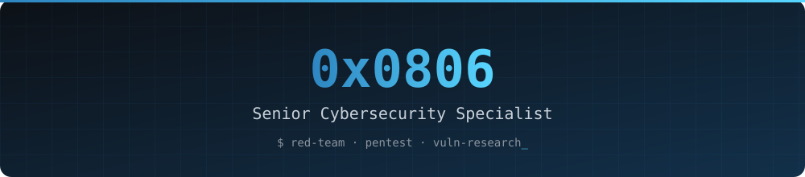

[LinkedIn](https://linkedin.com/in/0x0806) · [Portfolio](https://0x0806.me) · [Medium](https://medium.com/@0x0806) · [Twitter](https://twitter.com/0x0806)

## About

Offensive security practitioner focused on adversary emulation, penetration testing and vulnerability research. I help organisations understand how real attackers operate so they can build defenses that hold up under pressure.

## Focus Areas

| Domain | Scope |
|:--|:--|
| Adversary Emulation | MITRE ATT&CK, Cobalt Strike, Caldera |
| Penetration Testing | Web, mobile, network and cloud assessments; PCI DSS |
| Vulnerability Research | Zero-day discovery, CVE submissions, patch verification |
| Security Architecture | Defense-in-depth, EDR evasion research |
| Threat Intelligence | TTP analysis, malware reverse engineering, threat actor profiling |

## Featured Projects

<!--START_SECTION:featured-->
| Project | Description | Language | ⭐ |
|:--|:--|:--|--:|
| [**wifi-arsenal**](https://github.com/0x0806/wifi-arsenal) | A comprehensive WiFi penetration testing framework for security professionals | Python | 19 |
| [**wifi-deauther-esp8266**](https://github.com/0x0806/wifi-deauther-esp8266) | This comprehensive suite combines cutting-edge WiFi attack vectors, Bluetooth Low Energy (BLE) capabilities... | C++ | 8 |
| [**CTF-Arsenal**](https://github.com/0x0806/CTF-Arsenal) | A comprehensive web-based toolkit for Capture The Flag (CTF) competitions featuring 50+ specialized tools a... | JavaScript | 4 |
| [**ParallelSSH**](https://github.com/0x0806/ParallelSSH) | — | Python | 3 |
| [**UnleashedLLM**](https://github.com/0x0806/UnleashedLLM) | A sophisticated command-line interface tool for downloading, managing, and interacting with powerful AI mod... | Python | 3 |
| [**scripts**](https://github.com/0x0806/scripts) | — | Python | 2 |
<!--END_SECTION:featured-->

All repositories: [github.com/0x0806?tab=repositories](https://github.com/0x0806?tab=repositories)

## GitHub Overview

<!--START_SECTION:stats-->

Languages by original repo count 
     

<!--END_SECTION:stats-->

## Recent Activity

<!--START_SECTION:activity-->
- ⭐ Starred [cloudflare/security-audit-skill](https://github.com/cloudflare/security-audit-skill) · 2026-11-11
- ⭐ Starred [affaan-m/ECC](https://github.com/affaan-m/ECC) · 2026-11-10
- ⬆️ Pushed 1 commit to [0x0806/qsl_agent](https://github.com/0x0806/qsl_agent) · 2026-11-07
- ⬆️ Pushed 1 commit to [0x0806/qsl_agent](https://github.com/0x0806/qsl_agent) · 2026-11-07
- ⬆️ Pushed 1 commit to [0x0806/qsl_agent](https://github.com/0x0806/qsl_agent) · 2026-11-07
- ⬆️ Pushed 1 commit to [0x0806/qsl_agent](https://github.com/0x0806/qsl_agent) · 2026-11-07
<!--END_SECTION:activity-->

## Certifications

CEH · CRTP

## Contact

Open to consulting, security research collaboration and conference speaking. Reach me via [LinkedIn](https://linkedin.com/in/0x0806) or [0x0806.me](https://0x0806.me).

All offensive work is performed with explicit authorization and within an agreed scope. Tools and research published here are intended for education, CTFs and authorized security testing only.

<!--START_SECTION:updated-->
🕒 Auto-updated: 2026-11-11 23:47 UTC
<!--END_SECTION:updated-->

